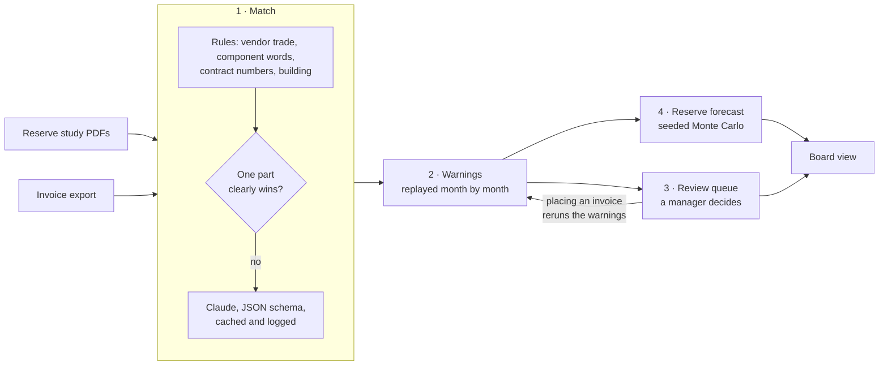

<div align="center">

# Capital Drift Monitor

**Is a homeowners association's money going where its reserve plan said it would?**

Matches every invoice to the reserve study, warns when a building part fails early, is put off or runs over budget, and forecasts which reserve fund runs short first.

[**Live demo →**](https://juyal-devashish.github.io/capital-drift/) &nbsp;·&nbsp; [How it works](#how-it-works) &nbsp;·&nbsp; [Results](#results-at-a-glance) &nbsp;·&nbsp; [Run it](#run-it)


</div>

## How it works, in one page

- **The problem:** an association plans its big repairs in a **reserve study** (every roof, boiler and parking lot, its life, its replacement cost, its year). The money is spent through **invoices** in another system, with vague memos. The two rarely meet, so a part failing early, a replacement put off or a project over budget shows up late.
- **What this does:** it files every invoice under the right part of the plan, watches spending against the plan month by month, puts every warning in front of a property manager with its evidence, and forecasts each reserve fund ten years ahead.
- **Who does what:** rules file most invoices and Claude handles only the unsure ones. Code, never the model, decides repair vs. replacement and raises the warnings. A property manager confirms or dismisses every flag, and the board reads the result.

> [!WARNING]
> **Synthetic data only.** All 20 associations, their reserve studies and ten years of invoices are generated, with problems planted on purpose so each step can be scored. The same author wrote the generator and the code that reads it, so the measured results are optimistic. The [live demo](https://juyal-devashish.github.io/capital-drift/) is read-only.

---

## How it works



1. **Matching.** Rules come first: vendor trade, words from the study's own component names and locations, contract numbers that link a deposit to its final bill, and the building named in the memo. When no single part clearly wins, the invoice is **unsure**, and only those go to Claude. Code decides repair or replacement (15% of the part's inflated replacement cost). The booked fund is never an input; it's compared afterwards to flag spend booked to the wrong fund.
2. **Warnings.** The history is replayed month by month, and each warning uses only invoices dated on or before the day it fires (a test checks this).
   - **Failing early:** a Poisson CUSUM on monthly repair *counts* against a usual rate learned from the portfolio by age, with its threshold fixed in advance from a simulated false-alarm rate.
   - **Past due:** the planned year plus 90 days has passed with no completed replacement.
   - **Over budget:** a project costs more than the plan plus a 15% contingency.
3. **Review queue.** Warnings and unsure invoices become items keyed by part and plan cycle, so a decision survives every rerun. Past-due warnings list candidate invoices that are the usual cause of a false alarm; placing one reruns the warnings at once and reports what cleared. Every action goes to an append-only log.
4. **Forecast.** Each reserve balance is replayed, then a seeded Monte Carlo runs over the study's schedule: past-due parts are due now, parts warned as failing early come due within three years, and replacement costs vary as much as the portfolio's own finished projects did.

## Results at a glance

On synthetic data, with rules tuned on one seed and other seeds held out:

| Step | Result |
|---|---|
| Invoice matching | **93%** filed under the right part with rules + Claude (rules alone: 87%), for $1.22 of AI calls |
| Warnings | **11 of 12** planted problems caught on the demo portfolio |
| Review queue | False alarms down from **4 to 1** after a manager checks 8 suggested invoices |
| Forecast | Called **24 of 26** associations that ran short, on data it had never seen (the plan alone: 19) |

Full tables, seeds and caveats are in [docs/results.md](docs/results.md). Regression floors in the tests hold these numbers and are never lowered.

## Features

**Matching**
- Rules use only what a client hands over: vendor, memo, amount, date and the study's component names.
- Claude (Opus 5.5, low effort, a JSON schema for the answer) sees only the unsure invoices. Every call is cached by request hash and logged, failures included, so re-scoring costs nothing.
- Wrong-fund flags for spend booked to the operating fund that belongs in reserve, and the reverse.

**Warnings and review**
- Failing-early, past-due and over-budget warnings, computed without look-ahead.
- A review queue where a rerun never undoes a person's confirm or dismiss, and a manager's answers live in their own "reviewed" set so the measured numbers still reproduce.
- Roles: board members read, property managers decide, admins can also rebuild the queue.

**Forecast and board view**
- Ten-year reserve forecasts with flat and rising-with-inflation contributions.
- A board view that shows which association runs short first.

**Engineering**
- Pure domain code: matching, warnings, the forecast and the board's status rule are pure functions. Nothing in `app/domain` imports the data generator, and a test enforces it.
- A synthetic generator (`app/synth`) that writes real reserve-study PDFs and parses them back, with an answer key that only the evaluation code reads.
- SQLite by default, Postgres tested (migrations checked up and down on Postgres 17), Docker images for the API and the UI.

## Known limits

- All data is synthetic, and results are optimistic for that reason.
- The forecast's band reflects replacement cost only. It held the actual balance 27–64% of the time in the backtest, against an 80% target.
- The forecast ignores the unpaid balance of a project already in progress.
- The board's 10% unplaced-invoice rule is a round number, not a tested one.
- Demo auth is static tokens behind one dependency, so swapping in SSO touches one function.

## Tech stack

| Layer | Technology |
|---|---|
| API | Python 3.12, FastAPI, Pydantic v2 |
| Data | SQLAlchemy 2, Alembic; SQLite by default, Postgres tested |
| Documents | pdfplumber reads the reserve studies; reportlab writes the synthetic ones |
| AI | Anthropic Python SDK, Claude API or Amazon Bedrock |
| UI | React 18, TypeScript, Vite; charts are plain SVG |
| Packaging | Docker images for the API and for the UI behind nginx |

## Run it

**Prerequisites:** Python 3.12 (with [uv](https://docs.astral.sh/uv/)) and Node 18+. No API key is needed for the demo.

```bash
git clone https://github.com/juyal-devashish/capital-drift.git && cd capital-drift
uv venv --seed --python 3.12 .venv && source .venv/bin/activate
make install && make demo     # synthetic portfolio, matches, warnings, review queue (no API calls)
make dev-backend              # API on :8000
make dev-frontend             # UI on http://localhost:5173 (second terminal)
```

Sign in as Max (property manager) to work the review queue.

| Command | What it does |
|---|---|
| `make test` | Backend tests and the frontend type check |
| `make lint` | Lint |
| `make up` then `make docker-demo` | The full stack in Docker on http://localhost:8080 |

More in [docs/development.md](docs/development.md); the full design is in [docs/design.md](docs/design.md).

## Repository layout

```
backend/
  app/domain/     matching, warnings, forecast, board status (pure functions)
  app/llm/        the Claude step for unsure invoices
  app/services/   review queue and the services behind the API and CLI
  app/synth/      synthetic portfolio generator with an answer key
  migrations/     Alembic migrations
  tests/          pytest, with regression floors on the measured results
frontend/         React + TypeScript UI (Vite), and the static read-only demo build
docs/             design.md, results.md, development.md
```

## License

[MIT](LICENSE) © 2026 Devashish Juyal
